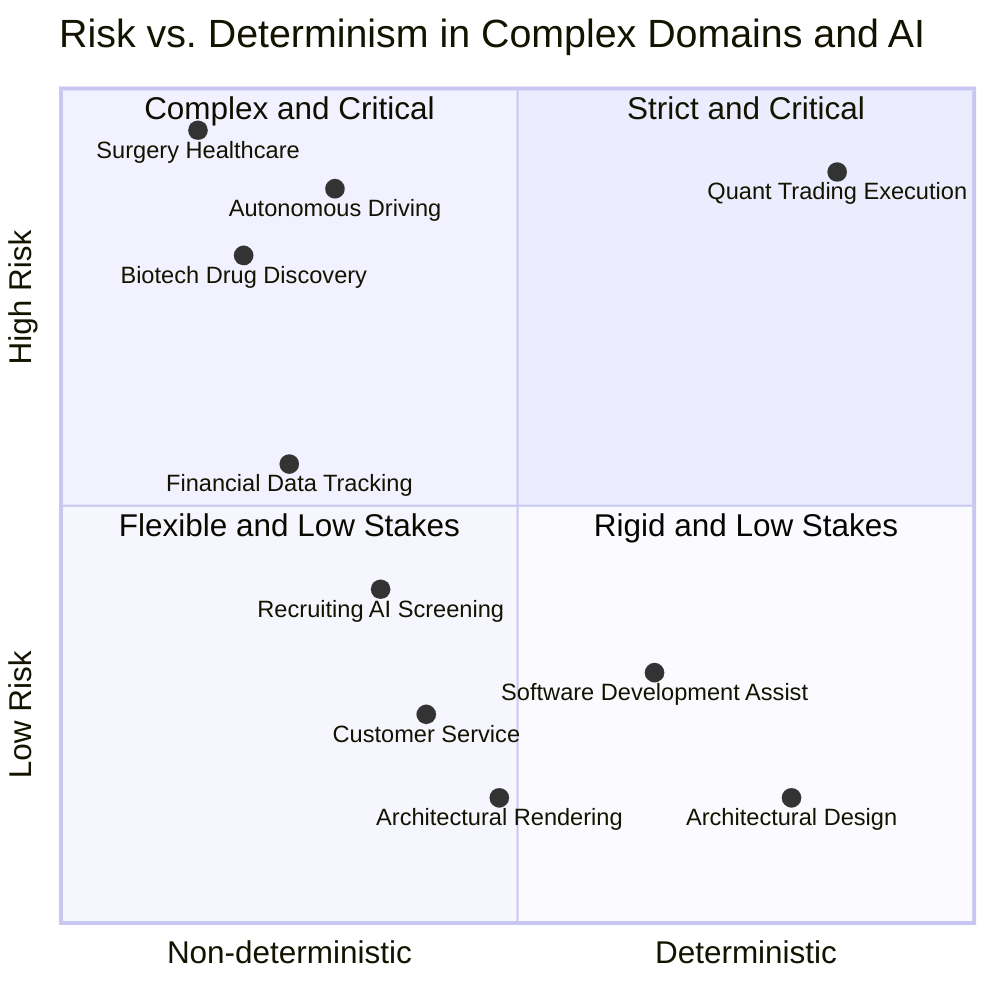

## Start with a simple quadrant chart

Let's make a 2x2 matrix. The x-axis represents determinism: given a specific input, how strictly can we constrain the output? The y-axis represents risk: if something goes wrong, how bad are the consequences?

Here are two examples.

Surgery: Unlike mass-produced objects, every patient is different, which makes surgery inherently nondeterministic. If something goes wrong, the consequences can be severe.

Another example is financial tracking. You can write code to parse specific formats, but the real challenge lies in handling the unpredictable, inconsistent, and highly fragmented ways different financial institutions export data. As a result, purely programmatic approaches have not solved the problem—RIP Intuit Mint, and less RIP Chase Blueprint—and the remaining products continue to struggle.

## My take

I don't see an AGI coming up any time sooner. My current bet is AI is best suited to low-risk, nondeterministic work.
